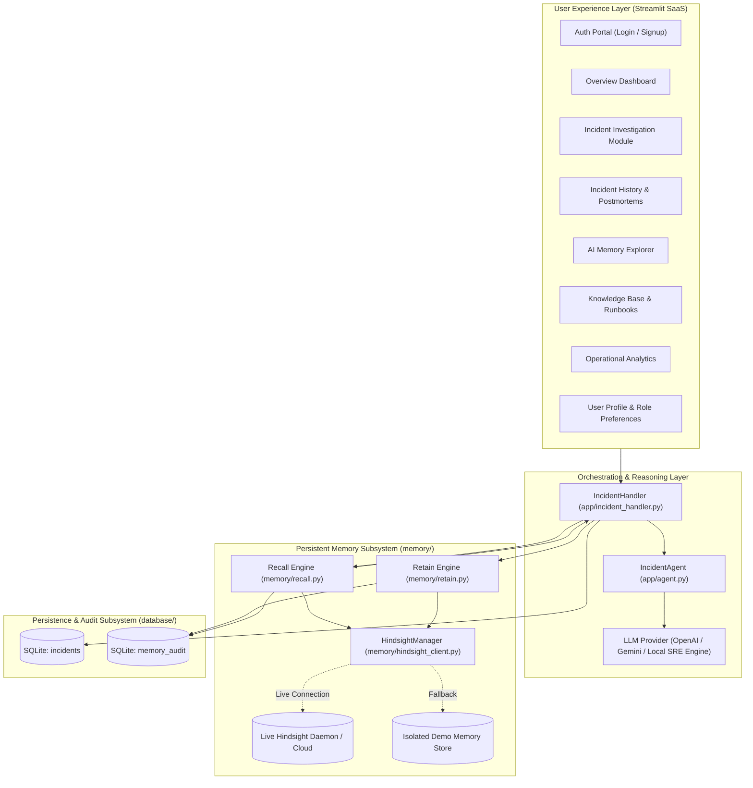
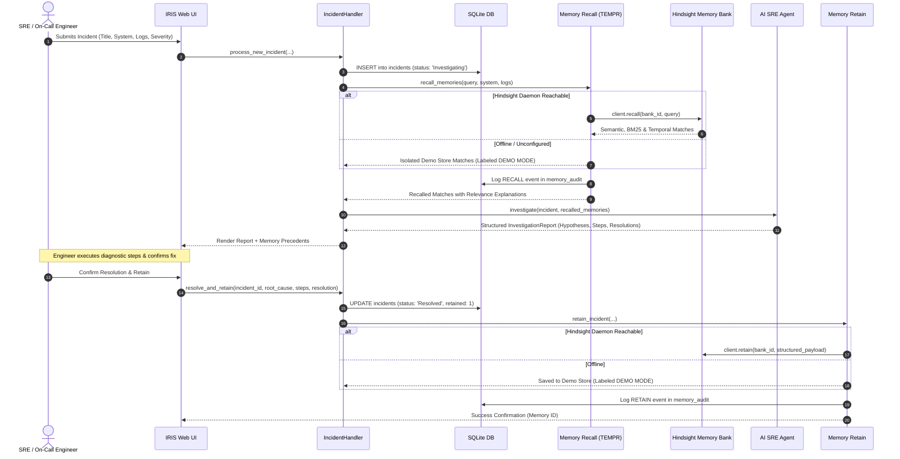

# IRIS System Architecture Document
### Intelligent Incident Response System
**Tagline: Turning Past Incidents into Future Intelligence.**

---

## 1. Executive Summary

**IRIS** is a specialized, production-ready AI incident response assistant designed to eliminate diagnostic repetition in Site Reliability Engineering (SRE) and DevOps workflows. Unlike stateless conversational agents that reset context across sessions, IRIS introduces durable, semantic memory retention powered by **Hindsight** (by Vectorize).

When an incident strikes, IRIS immediately correlates live diagnostic signatures, error logs, and affected infrastructure components against previously resolved incidents. Upon investigation sign-off, verified postmortem findings, diagnostic commands, and permanent resolutions are stored back into Hindsight. Future recurring failures benefit from that retained intelligence.

---

## 2. High-Level Architecture

The IRIS architecture is strictly modular and decoupled across user interface, agent reasoning, persistent memory, and relational storage.

---

## 3. End-to-End Incident Lifecycle Workflow

---

## 4. Hindsight Persistent Memory Integration

IRIS integrates directly with the official `hindsight-client` Python SDK (v1.2.0):

### 4.1 Retain Operation (`memory/retain.py`)
Incoming resolved incidents are structured into durable knowledge chunks:
- **Identifier:** Unique Incident ID (e.g. `INC-2026-0041`)
- **Metadata:** System, Category, Severity, Timestamp
- **Structured Sections:**
  - `INCIDENT SUMMARY & SYMPTOMS`
  - `ERROR LOGS & TECHNICAL SIGNATURES`
  - `CONFIRMED ROOT CAUSE`
  - `INVESTIGATION & TROUBLESHOOTING STEPS`
  - `VERIFIED RESOLUTION & REMEDIATION`
- **Context & Tags:** Automatically indexed for semantic vector search, BM25 keyword matching, and knowledge graph extraction.

### 4.2 Recall Operation (`memory/recall.py`)
Retrieval executes across four parallel channels via Hindsight's **TEMPR** architecture:
1. **Semantic Dense Vector Search:** Captures high-level failure intent and behavioral synonyms.
2. **Lexical Keyword Matching (BM25):** Matches exact error codes (e.g., `SQLSTATE 53300`, `OOM`, `NET::ERR_CERT_DATE_INVALID`).
3. **Graph Traversal:** Connects interdependent services (e.g., Auth Pods -> PgBouncer -> PostgreSQL).
4. **Temporal Context:** Correlates time-of-day and recent configuration changes.

### 4.3 Honest Offline Handling (DEMO MODE)
If no Hindsight server is active on the configured `HINDSIGHT_BASE_URL`:
- The system automatically transitions to an isolated local demo memory store.
- The UI surfaces a prominent `DEMO MODE` badge.
- Memory results are explicitly labeled as `DEMO MODE MEMORY`.
- At no point are synthetic memories falsely presented as live Hindsight data.

---

## 5. AI Reasoning Agent Architecture (`app/agent.py`)

The IRIS AI Agent is structured around strict Site Reliability Engineering standards:
- **Separation of Concerns:** Confirmed telemetry findings are strictly distinguished from historical precedents and AI hypotheses.
- **Provider Agnostic:** Configurable across OpenAI (`gpt-4o`, `gpt-4o-mini`), Google Gemini (`gemini-1.5-pro`), or a zero-configuration local deterministic SRE rule engine.
- **Honest Feedback:** When no LLM API key is supplied, IRIS displays an explicit setup notification and transparently serves deterministic heuristic reasoning rather than fabricating synthetic LLM responses.

---

## 6. Relational Database Schema (`database/db.py`)

All persistent application data is managed via SQLite (`iris.db`):

### `users` Table
| Column | Type | Constraints | Description |
|---|---|---|---|
| `id` | INTEGER | PRIMARY KEY AUTOINCREMENT | User sequence identifier |
| `name` | TEXT | NOT NULL | Responder full name |
| `email` | TEXT | UNIQUE NOT NULL | Work email address |
| `password_hash` | TEXT | NOT NULL | PBKDF2 with SHA-256 hash |
| `salt` | TEXT | NOT NULL | Cryptographic random hex salt |
| `role` | TEXT | NOT NULL | Role (Principal SRE, Incident Commander, etc.) |
| `department` | TEXT | NULLABLE | Organizational department |
| `bio` | TEXT | NULLABLE | SRE specializations and bio |
| `created_at` | TEXT | NOT NULL | Account creation UTC timestamp |

### `incidents` Table
| Column | Type | Constraints | Description |
|---|---|---|---|
| `id` | TEXT | PRIMARY KEY | Unique ID (`INC-YYYY-XXXXXX`) |
| `title` | TEXT | NOT NULL | Brief summary of failure |
| `category` | TEXT | NOT NULL | Database, Infrastructure, Security, etc. |
| `severity` | TEXT | NOT NULL | Critical, High, Medium, Low |
| `affected_system` | TEXT | NOT NULL | Target infrastructure component |
| `description` | TEXT | NOT NULL | User-reported symptoms |
| `error_logs` | TEXT | NULLABLE | Raw log trace or error messages |
| `status` | TEXT | NOT NULL | Investigating, Resolved, Closed |
| `root_cause` | TEXT | NULLABLE | Confirmed technical root cause |
| `steps_taken` | TEXT | NULLABLE | Diagnostic procedure executed |
| `resolution` | TEXT | NULLABLE | Permanent mitigation applied |
| `retained_in_memory` | INTEGER | DEFAULT 0 | 1 if indexed in Hindsight |
| `is_sample` | INTEGER | DEFAULT 0 | 1 if pre-seeded sample data |
| `created_at` | TEXT | NOT NULL | ISO 8601 UTC timestamp |
| `resolved_at` | TEXT | NULLABLE | ISO 8601 UTC timestamp |

### `memory_audit` Table
| Column | Type | Constraints | Description |
|---|---|---|---|
| `id` | INTEGER | PRIMARY KEY AUTOINCREMENT | Audit log sequence number |
| `action` | TEXT | NOT NULL | `RETAIN` or `RECALL` |
| `incident_id` | TEXT | NULLABLE | Associated incident identifier |
| `query` | TEXT | NULLABLE | Search query issued |
| `content_summary` | TEXT | NULLABLE | Brief descriptor of stored/retrieved payload |
| `bank_id` | TEXT | NOT NULL | Hindsight bank queried |
| `mode` | TEXT | NOT NULL | `HINDSIGHT` or `DEMO MODE` |
| `success` | INTEGER | DEFAULT 1 | 1 for success, 0 for failure |
| `timestamp` | TEXT | NOT NULL | ISO 8601 UTC timestamp |
| `details` | TEXT | NULLABLE | Execution telemetry / exception notes |

---

## 7. Security and Reliability Guarantees

1. **Zero Secret Leakage:** No API keys or tokens are stored in the database, committed to Git, or exposed to the client browser.
2. **Input Validation:** Mandatory field validation and character cleansing prevents injection and database corruption.
3. **Deterministic Fallbacks:** The platform maintains 100% operational availability even when external AI or memory services are unreachable.
4. **Auditability:** Every memory mutation and lookup produces a queryable audit record in SQLite.
